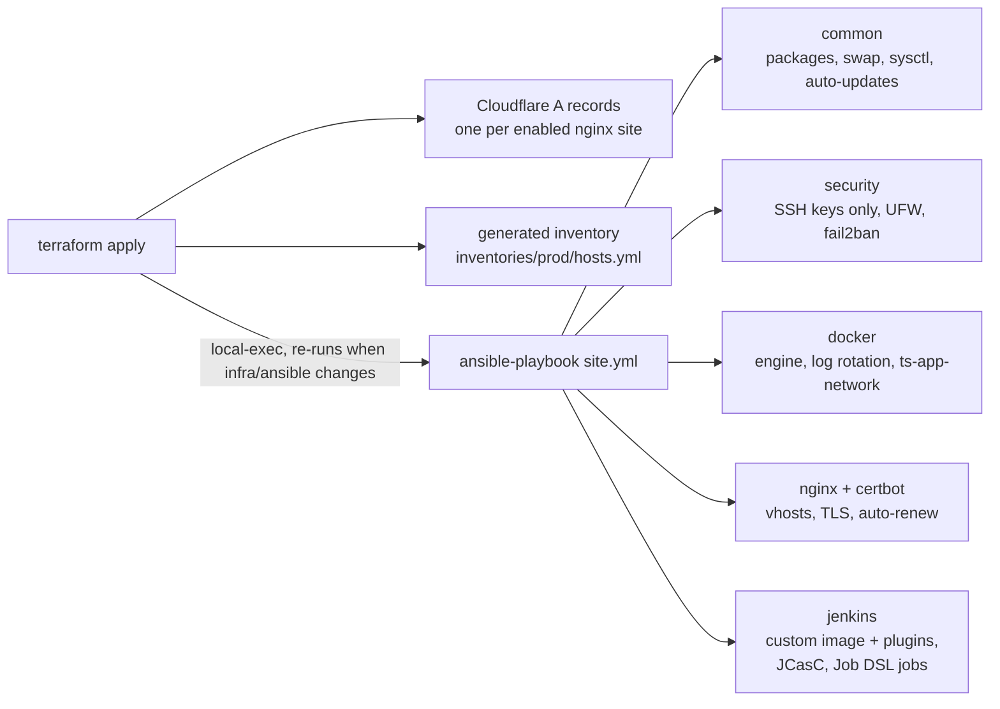
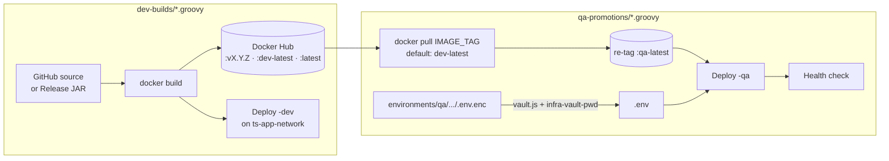

# ts-infra-devops-5005

Infrastructure-as-code for the `tanmaysinghx` platform, in two layers:

1. **Server**: Terraform + Ansible turn a blank Ubuntu VPS into the full platform (hardened OS, Docker, nginx + Let's Encrypt, Jenkins with every job and credential pre-configured). No manual setup.
2. **Delivery**: Jenkins pipelines build each app as a Docker image, push it to Docker Hub (`tanmaysinghx/*`), and run it on the VPS behind nginx. Secrets stay **encrypted** in this repo.

---

## Contents
- [New VPS from scratch](#new-vps-from-scratch)
- [How the server automation works](#how-the-server-automation-works)
- [Day-2 operations](#day-2-operations)
- [Repository layout](#repository-layout)
- [Delivery flow](#delivery-flow) · [Pipeline catalogue](#pipeline-catalogue)
- [Secrets & configuration](#secrets--configuration)
- [Adding a new application](#adding-a-new-application)
- [Contributing / branching](CONTRIBUTING.md)

---

## New VPS from scratch

**Prerequisites (on your laptop):** Terraform ≥ 1.6, Ansible (`pipx install ansible-core`), an SSH key (`~/.ssh/id_ed25519`), and a Cloudflare API token with **Zone → DNS → Edit** on `tanmaysinghx.com`.

```bash
# 0. One-time: secrets. Keep the vault password file outside the repo.
echo 'a-long-random-passphrase' > ~/.ansible/ts-infra-vault-pass && chmod 600 ~/.ansible/ts-infra-vault-pass
cd infra/ansible/inventories/prod/group_vars/all
cp secrets.yml.example secrets.yml        # fill in admin password, Docker Hub token, vault pwd, .env files
ansible-vault encrypt secrets.yml --vault-password-file ~/.ansible/ts-infra-vault-pass
cd -                                      # commit the ENCRYPTED secrets.yml

# 1. Buy the VPS (Ubuntu 24.04+ LTS). Install your key using the password from the provider's email:
make bootstrap IP=<new-ip>

# 2. Point Terraform at it
cp infra/terraform/environments/prod/terraform.tfvars.example infra/terraform/environments/prod/terraform.tfvars
#    edit server_ip = "<new-ip>"
export TF_VAR_cloudflare_api_token=<token>

# 3. Build everything
make init
make apply      # creates/updates DNS records, then runs the whole Ansible playbook
```

About 10 minutes later you have `https://jenkins.tanmaysinghx.com` with the admin login from `secrets.yml`, all jobs created and credentials loaded. Run the app jobs to deploy the containers.

> **Moving from an existing server?** The Jenkins container reuses the Docker volume `jenkins_jenkins_home`. To keep build history, copy it across before step 3:
> `ssh old 'docker run --rm -v jenkins_jenkins_home:/v alpine tar -C /v -cz .' | ssh new 'docker volume create jenkins_jenkins_home && docker run --rm -i -v jenkins_jenkins_home:/v alpine tar -C /v -xz'`
> To skip Let's Encrypt rate limits while testing a box, add `-e certbot_staging=true` to the playbook run.

> **DNS records that already exist in Cloudflare** must be imported once, or the create fails:
> `terraform -chdir=infra/terraform/environments/prod import 'module.dns[0].cloudflare_dns_record.a["jenkins"]' <zone_id>/<record_id>`
> (record ids: `curl -s -H "Authorization: Bearer $TF_VAR_cloudflare_api_token" https://api.cloudflare.com/client/v4/zones/<zone_id>/dns_records | jq '.result[]|{name,id}'`).
> Or delete them in the dashboard and let Terraform recreate them.

---

## How the server automation works



**Terraform** owns what lives outside the server (DNS) and drives provisioning. **Ansible** owns everything on the server, idempotently: re-running it is always safe and only changes what drifted.

| Concern | Where it is defined |
|---|---|
| Sites / domains / upstream ports | `infra/ansible/inventories/prod/group_vars/all/main.yml` → `nginx_sites` (Terraform reads the same file for DNS) |
| Jenkins jobs | same file → `jenkins_jobs` (Job DSL, recreated on every Jenkins start) |
| Jenkins plugins | `infra/ansible/roles/jenkins/files/plugins.txt` (baked into the image) |
| Jenkins system config & credentials | `infra/ansible/roles/jenkins/templates/jenkins.yaml.j2` (Configuration-as-Code) |
| Secrets (admin pwd, Docker Hub, GitHub, vault pwd, `.env` files) | `inventories/prod/group_vars/all/secrets.yml` (ansible-vault) |
| Firewall extras (e.g. WireGuard 51820/udp) | `firewall_extra_rules` |
| SSH keys allowed in | `admin_ssh_public_keys` (password login is disabled) |

What the playbook sets up:

- **OS**: package upgrade, base tools, UTC, 2 GB swap, `vm.swappiness=10`, unattended security upgrades.
- **Security**: your public key(s) only. Password and root login are off, and the play refuses to run if no key is configured. UFW allows 22/80/443 plus extras. fail2ban guards SSH.
- **Docker**: official repo, Compose plugin, json-file log rotation (10 MB × 3), `ts-app-network`, weekly prune of old images and build cache.
- **nginx**: one vhost per site (HTTP→HTTPS, HSTS, websocket support for Jenkins, per-site body size and timeouts). A catch-all server drops requests for unknown hosts or the raw IP. `server_tokens off`.
- **Let's Encrypt**: webroot certificates issued automatically. Renewal runs on `certbot.timer` with an nginx reload hook.
- **Jenkins**: `jenkins/jenkins:lts-jdk25` plus plugins, the setup wizard skipped, bound to `127.0.0.1:8080` behind nginx, Docker socket access through the host docker gid. Credentials `dockerhub-creds`, `github-token`, `infra-vault-pwd`, `oracle-db-password`, `hidenseek-vpn-dev-env` and `selfie-backend-dev-env` are created from `secrets.yml` (any left empty are skipped).
- **hidenseek-agent** (optional, `hidenseek_agent_enabled: true`): installs WireGuard tools, the agent binary (not committed, so drop it in `roles/hidenseek_agent/files/`) and its systemd unit.

---

## Day-2 operations

```bash
make help                    # list targets
make check                   # dry run: shows the diff Ansible would apply, changes nothing
make provision               # apply all roles
make provision TAGS=nginx    # one layer: common | security | docker | nginx | certbot | jenkins | hidenseek
make dns                     # only Cloudflare records
make vault-edit              # edit encrypted secrets
make lint                    # what CI runs
```

| Task | How |
|---|---|
| Add a subdomain / site | Add to `nginx_sites` → `make apply` (DNS + cert + vhost) |
| Add a Jenkins job | Add to `jenkins_jobs` → `make provision TAGS=jenkins` |
| Add / update a plugin | Edit `plugins.txt` → `make provision TAGS=jenkins` (rebuilds the image) |
| Upgrade Jenkins core | `ssh vps 'cd /opt/jenkins && docker compose build --pull && docker compose up -d'` |
| Rotate a secret | `make vault-edit` → `make provision TAGS=jenkins` |

Jenkins system settings and credentials are owned by Configuration-as-Code, so changes made in the UI are overwritten on the next restart. Put them in the template instead. Jobs keep their build history across restarts.

---

## Repository layout

```
.
├── infra/
│   ├── terraform/
│   │   ├── modules/
│   │   │   ├── cloudflare-dns/      # A records for the VPS
│   │   │   └── ansible-provision/   # inventory + ansible-playbook runner
│   │   └── environments/prod/       # root module: tfvars, providers, state
│   └── ansible/
│       ├── inventories/prod/        # hosts.yml (generated), group_vars/all/{main,secrets}.yml
│       ├── playbooks/site.yml
│       └── roles/                   # common, security, docker, nginx, certbot, jenkins, hidenseek_agent
├── application-pipelines/
│   ├── dev-builds/                  # Build → push → (optionally) deploy to DEV
│   └── qa-promotions/               # Promote an existing image to QA and deploy
├── api-gateways/                    # ts-api-gateway-1701 dev build & QA deploy
├── database-pipelines/              # Oracle Database Free container
├── middleware-pipelines/kafka/      # Kafka (KRaft, single node) + Kafka UI
├── monitoring-pipelines/            # Prometheus, Loki, Promtail, Grafana (+ configs & dashboards)
├── environments/<dev|qa|prod>/configs/<app>/
│   ├── .env.enc                     # vault-encrypted runtime config (committed)
│   └── .env.example                 # documented, non-secret template (committed)
├── scripts/vault.js                 # AES-256-CBC encrypt/decrypt CLI used by the pipelines
├── docs/vault-usage.md
├── Makefile                         # entry point: make help
└── .github/                         # CI (lint/validate/secret guard), PR template, CODEOWNERS
```

> Pipeline script paths are referenced by Jenkins jobs, so moving a `.groovy` file means updating `jenkins_jobs` in the same PR.

---

## Delivery flow



**Image tag convention**

| Tag | Produced by | Meaning |
|---|---|---|
| `vX.Y.Z` / build tag | dev build | Immutable version |
| `dev-latest` | dev build | Latest DEV build — default source for QA promotion |
| `latest` | dev build (release-JAR & hidenseek pipelines) | Same as `dev-latest` |
| `qa-latest` | QA promotion | Image currently promoted to QA |

---

## Pipeline catalogue

### Applications

| App | Dev pipeline | Dev source | Dev port (host → container) | QA pipeline | QA port |
|---|---|---|---|---|---|
| `eggless-observability` | `application-pipelines/dev-builds/eggless-observability.groovy` | GitHub Release JAR | `127.0.0.1:8098 → 8080` (nginx: eggless.tanmaysinghx.com) | ✅ | `8080 → 8080` |
| `portal-sso` | `application-pipelines/dev-builds/portal-sso.groovy` | GitHub Release JAR | `127.0.0.1:8090 → 8090` (nginx: portal.tanmaysinghx.com) | ✅ | `8090 → 8090` |
| `opsnow` | `application-pipelines/dev-builds/opsnow.groovy` | Release JAR, or source (`BUILD_FROM_SOURCE`) | `127.0.0.1:8085 → 8085` | ✅ | `8085 → 8085` |
| `opencourier` | `application-pipelines/dev-builds/opencourier.groovy` | GitHub Release JAR | `127.0.0.1:8082 → 8082` | — | — |
| `hidenseek-vpn` | `application-pipelines/dev-builds/hidenseek-vpn.groovy` | Source (`GIT_REF`), runs tests | `127.0.0.1:8095 → 8090` (nginx in front) | — | — |
| `selfie-backend` | `application-pipelines/dev-builds/selfie-backend.groovy` | Source (`GIT_REF`, `backend/` of selfie-portfolio), runs tests | `127.0.0.1:8099 → 8080` (nginx: selfie.tanmaysinghx.com) | — | — |
| `ts-auth-service-1625` | `application-pipelines/dev-builds/ts-auth-service-1625.groovy` | Source (`main`) | build & push only | ✅ | `1625 → 1625` |
| `ts-api-engine-service-1606` | `application-pipelines/dev-builds/ts-api-engine-service-1606.groovy` | Source (`main`) | build & push only | ✅ | `1606 → 1606` |
| `ts-api-gateway-1701` | `api-gateways/dev-builds/ts-api-gateway-1701-pipeline-dev.groovy` | Source (`main`) | build & push only | ✅ (`api-gateways/qa-promotions/`) | `1701 → 8080` |

Host ports are Jenkins parameters (`DEV_PORT` / `QA_PORT`) on the newer pipelines and can be overridden per run.

### Common parameters

| Parameter | Pipelines | Default | Purpose |
|---|---|---|---|
| `RELEASE_TAG` | release-JAR dev builds | `latest` | GitHub Release to package (`latest` resolves via GitHub API) |
| `GIT_REF` | hidenseek-vpn | `main` | Branch/tag to build |
| `IMAGE_TAG` | QA promotions | `latest` → `dev-latest` | Image to promote |
| `DEPLOY_TO_DEV` | dev builds | `true` | Run the deploy stage |
| `PUSH_TO_DOCKERHUB` | dev builds | `true` | Push images (failures are non-fatal) |
| `DOCKERHUB_CRED_ID` | newer pipelines | `dockerhub-creds` | Docker Hub credential to use |
| `BIND_ADDRESS` | portal-sso, eggless-observability, opsnow, opencourier (dev) | `127.0.0.1` | Host interface for the published port. Keep loopback: Docker-published ports bypass UFW, so `0.0.0.0` exposes the app directly to the internet |

### Platform services

| Pipeline | Containers | Ports | Network |
|---|---|---|---|
| `database-pipelines/oracle-db-pipeline.groovy` | `oracle-db` (Oracle Database Free) | `1521`, `5500` (EM Express) | `backend-database-net` |
| `middleware-pipelines/kafka/kafka-pipeline.groovy` | `kafka-server` (KRaft), `kafka-ui` | `9092`, `8085 → 8080` | `kafka-network` |
| `monitoring-pipelines/Jenkinsfile.prometheus` | `prometheus-1701` | `9090` | `gateway-observability-net` |
| `monitoring-pipelines/Jenkinsfile.loki` | `loki-1701` | `3100` | `gateway-observability-net` |
| `monitoring-pipelines/Jenkinsfile.promtail` | `promtail-1701` (reads Docker logs) | — | `gateway-observability-net` |
| `monitoring-pipelines/Jenkinsfile.grafana` | `grafana-1701` (Prometheus + Loki datasources, gateway dashboard provisioned) | `3000` | `gateway-observability-net` |

Deploy the monitoring stack in this order: **Prometheus → Loki → Promtail → Grafana**.

---

## Secrets & configuration

Runtime config lives at `environments/<env>/configs/<app>/`:

- `.env.example` — every key the app reads, with safe placeholder values. Start here.
- `.env.enc` — the real values, encrypted with `scripts/vault.js` (AES-256-CBC, key derived from `infra-vault-pwd` via scrypt).

```bash
# Requires Node.js 20+
cp environments/qa/configs/portal-sso/.env.example environments/qa/configs/portal-sso/.env
# ...edit real values...
node scripts/vault.js encrypt environments/qa/configs/portal-sso/.env "$VAULT_PWD"
rm environments/qa/configs/portal-sso/.env      # plaintext is git-ignored, but don't leave it around
git add environments/qa/configs/portal-sso/.env.enc
```

At deploy time pipelines decrypt inside a throw-away `node:20-alpine` container, mount the resulting `.env` into the app container, and delete it during cleanup. If no `.env.enc` exists the app starts with its image defaults. See [`docs/vault-usage.md`](docs/vault-usage.md) for details.

**Rules**
- Never commit a plaintext `.env` — `.gitignore` blocks `.env` / `*.env` (except `*.env.example`).
- Pass secrets to `sh` steps with **single-quoted** Groovy strings so the shell, not Groovy, expands them (prevents leaks in build logs).
- Rotating `infra-vault-pwd` means re-encrypting every `.env.enc`.

---

## Adding a new application

1. Copy the closest existing pipeline (`dev-builds/portal-sso.groovy` for release-JAR apps, `dev-builds/hidenseek-vpn.groovy` for source builds) and update `APP_NAME`, `GITHUB_REPO`, the container port and `DEV_PORT`. Publish on `127.0.0.1` only.
2. Pick a host port not already listed in the tables above.
3. Add `environments/<env>/configs/<app>/.env.example`, and a `.env.enc` if the app needs secrets.
4. Register it in `infra/ansible/inventories/prod/group_vars/all/main.yml`: a `jenkins_jobs` entry, plus an `nginx_sites` entry if it needs a public hostname. Then run `make apply`.
5. For QA, copy a `qa-promotions/*.groovy` file and set `APP_NAME`, `QA_PORT` and the health-check URL.
6. Update the catalogue in this README.

---

## Known issues / follow-ups

- **QA promotions and the `ts-*` services** still publish on `0.0.0.0` (`QA_PORT`, `1625`, `1606`, `1701`). Bind them to `127.0.0.1` and put them behind nginx before running them on the internet-facing VPS.
- **Terraform state** is local by default. Switch to the commented R2/S3 backend in `infra/terraform/environments/prod/versions.tf` before more than one machine runs `terraform apply`.

- **Port collisions on a shared host:** `opsnow` (dev & QA) and `kafka-ui` all default to host port `8085`; `portal-sso` dev & QA both default to `8090`. Override `DEV_PORT`/`QA_PORT` if they share a Docker host.
- **Grafana admin password** is hard-coded to `admin` in `Jenkinsfile.grafana`. It applies only on first boot of the persisted volume; change it in the UI and consider moving it to a Jenkins credential.
- **Floating image tags** (`apache/kafka:latest`, `provectuslabs/kafka-ui:latest`, `grafana/promtail:latest`, Oracle `free:latest`) make redeploys non-reproducible — pin versions.
- **Kafka** exposes `PLAINTEXT` on a public IP with no auth.
- **Duplicated pipeline logic** (Docker CLI bootstrap, tag resolution, vault decrypt) could move into a Jenkins Shared Library.
- **Vault** uses a static scrypt salt and unauthenticated CBC; a move to AES-256-GCM with a random per-file salt would need a one-time re-encryption of all `.env.enc` files.
