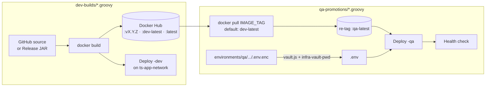

# ts-infra-devops-5005

Jenkins pipelines, per-environment configuration and the monitoring stack for the `tanmaysinghx` platform. Each application is built as a Docker image, pushed to Docker Hub (`tanmaysinghx/*`), and run as a container on the Docker host behind Jenkins. Secrets are kept in this repo **encrypted** and decrypted only while a pipeline runs.

---

## Repository layout

```
.
├── application-pipelines/
│   ├── dev-builds/          # Build → push → (optionally) deploy to DEV
│   └── qa-promotions/       # Promote an existing image to QA and deploy
├── api-gateways/
│   ├── dev-builds/          # ts-api-gateway-1701 build
│   └── qa-promotions/       # ts-api-gateway-1701 QA deploy
├── database-pipelines/      # Oracle Database Free container
├── middleware-pipelines/
│   └── kafka/               # Kafka (KRaft, single node) + Kafka UI
├── monitoring-pipelines/    # Prometheus, Loki, Promtail, Grafana (+ configs & dashboards)
├── environments/
│   └── <dev|qa|prod>/configs/<app>/
│       ├── .env.enc         # vault-encrypted runtime config (committed)
│       └── .env.example     # documented, non-secret template (committed)
├── scripts/
│   └── vault.js             # AES-256-CBC encrypt/decrypt CLI used by the pipelines
└── docs/
    └── vault-usage.md       # Secret vault guide
```

---

## Delivery flow



**Image tag convention**

| Tag | Produced by | Meaning |
|---|---|---|
| `vX.Y.Z` / build tag | dev build | Immutable version |
| `dev-latest` | dev build | Latest DEV build — default source for QA promotion |
| `latest` | dev build (release-JAR & hidenseek pipelines) | Same as `dev-latest` |
| `qa-latest` | QA promotion | Image currently promoted to QA |

---

## Pipeline catalogue

### Applications

| App | Dev pipeline | Dev source | Dev port (host → container) | QA pipeline | QA port |
|---|---|---|---|---|---|
| `eggless-observability` | `application-pipelines/dev-builds/eggless-observability.groovy` | GitHub Release JAR | `8098 → 8080` | ✅ | `8080 → 8080` |
| `portal-sso` | `application-pipelines/dev-builds/portal-sso.groovy` | GitHub Release JAR | `8090 → 8090` | ✅ | `8090 → 8090` |
| `opsnow` | `application-pipelines/dev-builds/opsnow.groovy` | Release JAR, or source (`BUILD_FROM_SOURCE`) | `8085 → 8085` | ✅ | `8085 → 8085` |
| `opencourier` | `application-pipelines/dev-builds/opencourier.groovy` | GitHub Release JAR | `8082 → 8082` | — | — |
| `hidenseek-vpn` | `application-pipelines/dev-builds/hidenseek-vpn.groovy` | Source (`GIT_REF`), runs tests | `127.0.0.1:8095 → 8090` (nginx in front) | — | — |
| `ts-auth-service-1625` | `application-pipelines/dev-builds/ts-auth-service-1625.groovy` | Source (`main`) | build & push only | ✅ | `1625 → 1625` |
| `ts-api-engine-service-1606` | `application-pipelines/dev-builds/ts-api-engine-service-1606.groovy` | Source (`main`) | build & push only | ✅ | `1606 → 1606` |
| `ts-api-gateway-1701` | `api-gateways/dev-builds/ts-api-gateway-1701-pipeline-dev.groovy` | Source (`main`) | build & push only | ✅ (`api-gateways/qa-promotions/`) | `1701 → 8080` |

Host ports are Jenkins parameters (`DEV_PORT` / `QA_PORT`) on the newer pipelines and can be overridden per run.

### Common parameters

| Parameter | Pipelines | Default | Purpose |
|---|---|---|---|
| `RELEASE_TAG` | release-JAR dev builds | `latest` | GitHub Release to package (`latest` resolves via GitHub API) |
| `GIT_REF` | hidenseek-vpn | `main` | Branch/tag to build |
| `IMAGE_TAG` | QA promotions | `latest` → `dev-latest` | Image to promote |
| `DEPLOY_TO_DEV` | dev builds | `true` | Run the deploy stage |
| `PUSH_TO_DOCKERHUB` | dev builds | `true` | Push images (failures are non-fatal) |
| `DOCKERHUB_CRED_ID` | newer pipelines | `dockerhub-creds` | Docker Hub credential to use |

### Platform services

| Pipeline | Containers | Ports | Network |
|---|---|---|---|
| `database-pipelines/oracle-db-pipeline.groovy` | `oracle-db` (Oracle Database Free) | `1521`, `5500` (EM Express) | `backend-database-net` |
| `middleware-pipelines/kafka/kafka-pipeline.groovy` | `kafka-server` (KRaft), `kafka-ui` | `9092`, `8085 → 8080` | `kafka-network` |
| `monitoring-pipelines/Jenkinsfile.prometheus` | `prometheus-1701` | `9090` | `gateway-observability-net` |
| `monitoring-pipelines/Jenkinsfile.loki` | `loki-1701` | `3100` | `gateway-observability-net` |
| `monitoring-pipelines/Jenkinsfile.promtail` | `promtail-1701` (reads Docker logs) | — | `gateway-observability-net` |
| `monitoring-pipelines/Jenkinsfile.grafana` | `grafana-1701` (Prometheus + Loki datasources, gateway dashboard provisioned) | `3000` | `gateway-observability-net` |

Deploy the monitoring stack in this order: **Prometheus → Loki → Promtail → Grafana**.

---

## Jenkins setup

### Required plugins
Pipeline, Git, Credentials Binding. The agent needs Docker access (`/var/run/docker.sock`); the newer pipelines install a static Docker CLI into the workspace if none is on `PATH`.

### Credentials

| ID | Kind | Used by |
|---|---|---|
| `dockerhub-creds` | Username with password | All image pushes/pulls |
| `github-token` | Username with password / token | `ts-*` source checkouts |
| `infra-vault-pwd` | Secret text | Decrypting `environments/**/.env.enc` |
| `hidenseek-vpn-dev-env` | Secret file | hidenseek-vpn `.env` when no `.env.enc` exists |
| `oracle-db-password` | Secret text | Oracle `ORACLE_PWD` |

### Creating a job
1. **New Item → Pipeline**.
2. *Pipeline script from SCM* → Git → `https://github.com/tanmaysinghx/ts-infra-devops-5005.git`, branch `*/main`.
3. *Script Path* → e.g. `application-pipelines/dev-builds/portal-sso.groovy`.
4. Run once with defaults so Jenkins registers the parameters.

---

## Secrets & configuration

Runtime config lives at `environments/<env>/configs/<app>/`:

- `.env.example` — every key the app reads, with safe placeholder values. Start here.
- `.env.enc` — the real values, encrypted with `scripts/vault.js` (AES-256-CBC, key derived from `infra-vault-pwd` via scrypt).

```bash
# Requires Node.js 20+
cp environments/qa/configs/portal-sso/.env.example environments/qa/configs/portal-sso/.env
# ...edit real values...
node scripts/vault.js encrypt environments/qa/configs/portal-sso/.env "$VAULT_PWD"
rm environments/qa/configs/portal-sso/.env      # plaintext is git-ignored, but don't leave it around
git add environments/qa/configs/portal-sso/.env.enc
```

At deploy time pipelines decrypt inside a throw-away `node:20-alpine` container, mount the resulting `.env` into the app container, and delete it during cleanup. If no `.env.enc` exists the app starts with its image defaults. See [`docs/vault-usage.md`](docs/vault-usage.md) for details.

**Rules**
- Never commit a plaintext `.env` — `.gitignore` blocks `.env` / `*.env` (except `*.env.example`).
- Pass secrets to `sh` steps with **single-quoted** Groovy strings so the shell, not Groovy, expands them (prevents leaks in build logs).
- Rotating `infra-vault-pwd` means re-encrypting every `.env.enc`.

---

## Adding a new application

1. Copy the closest existing pipeline (`dev-builds/portal-sso.groovy` for release-JAR apps, `dev-builds/hidenseek-vpn.groovy` for source builds) and update `APP_NAME`, `GITHUB_REPO`, container port and `DEV_PORT`.
2. Pick a host port not already listed in the tables above.
3. Add `environments/<env>/configs/<app>/.env.example`, and a `.env.enc` if the app needs secrets.
4. For QA, copy a `qa-promotions/*.groovy` file and set `APP_NAME`, `QA_PORT` and the health-check URL.
5. Update the catalogue in this README.

---

## Known issues / follow-ups

- **Port collisions on a shared host:** `opsnow` (dev & QA) and `kafka-ui` all default to host port `8085`; `portal-sso` dev & QA both default to `8090`. Override `DEV_PORT`/`QA_PORT` if they share a Docker host.
- **Grafana admin password** is hard-coded to `admin` in `Jenkinsfile.grafana`. It applies only on first boot of the persisted volume; change it in the UI and consider moving it to a Jenkins credential.
- **Floating image tags** (`apache/kafka:latest`, `provectuslabs/kafka-ui:latest`, `grafana/promtail:latest`, Oracle `free:latest`) make redeploys non-reproducible — pin versions.
- **Kafka** exposes `PLAINTEXT` on a public IP with no auth.
- **Duplicated pipeline logic** (Docker CLI bootstrap, tag resolution, vault decrypt) could move into a Jenkins Shared Library.
- **Vault** uses a static scrypt salt and unauthenticated CBC; a move to AES-256-GCM with a random per-file salt would need a one-time re-encryption of all `.env.enc` files.
